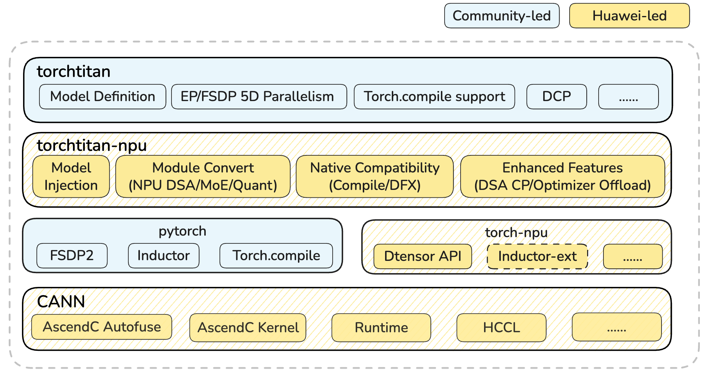

<div align="center" markdown="1">

# torchtitan-npu

<h4>基于 torchtitan 的昇腾全流程大模型训练适配插件</h4>

[](#特性支持概览)
[](https://gitcode.com/cann/torchtitan-npu/tree/master/LICENSE)
[](https://gitcode.com/cann/torchtitan-npu/blob/master/docs/community/governance.md)
[](https://gitcode.com/cann/community/tree/master/CANN/sigs/framework-adapter)
[](https://pypi.org/project/torchtitan-npu/)
[![zread](https://img.shields.io/badge/Ask_Zread-_.svg?style=plastic&color=00b0aa&labelColor=000000&logo=data%3Aimage%2Fsvg%2Bxml%3Bbase64%2CPHN2ZyB3aWR0aD0iMTYiIGhlaWdodD0iMTYiIHZpZXdCb3g9IjAgMCAxNiAxNiIgZmlsbD0ibm9uZSIgeG1sbnM9Imh0dHA6Ly93d3cudzMub3JnLzIwMDAvc3ZnIj4KPHBhdGggZD0iTTQuOTYxNTYgMS42MDAxSDIuMjQxNTZDMS44ODgxIDEuNjAwMSAxLjYwMTU2IDEuODg2NjQgMS42MDE1NiAyLjI0MDFWNC45NjAxQzEuNjAxNTYgNS4zMTM1NiAxLjg4ODEgNS42MDAxIDIuMjQxNTYgNS42MDAxSDQuOTYxNTZDNS4zMTUwMiA1LjYwMDEgNS42MDE1NiA1LjMxMzU2IDUuNjAxNTYgNC45NjAxVjIuMjQwMUM1LjYwMTU2IDEuODg2NjQgNS4zMTUwMiAxLjYwMDEgNC45NjE1NiAxLjYwMDFaIiBmaWxsPSIjZmZmIi8%2BCjxwYXRoIGQ9Ik00Ljk2MTU2IDEwLjM5OTlIMi4yNDE1NkMxLjg4ODEgMTAuMzk5OSAxLjYwMTU2IDEwLjY4NjQgMS42MDE1NiAxMS4wMzk5VjEzLjc1OTlDMS42MDE1NiAxNC4xMTM0IDEuODg4MSAxNC4zOTk5IDIuMjQxNTYgMTQuMzk5OUg0Ljk2MTU2QzUuMzE1MDIgMTQuMzk5OSA1LjYwMTU2IDE0LjExMzQgNS42MDE1NiAxMy43NTk5VjExLjAzOTlDNS42MDE1NiAxMC42ODY0IDUuMzE1MDIgMTAuMzk5OSA0Ljk2MTU2IDEwLjM5OTlaIiBmaWxsPSIjZmZmIi8%2BCjxwYXRoIGQ9Ik0xMy43NTg0IDEuNjAwMUgxMS4wMzg0QzEwLjY4NSAxLjYwMDEgMTAuMzk4NCAxLjg4NjY0IDEwLjM5ODQgMi4yNDAxVjQuOTYwMUMxMC4zOTg0IDUuMzEzNTYgMTAuNjg1IDUuNjAwMSAxMS4wMzg0IDUuNjAwMUgxMy43NTg0QzE0LjExMTkgNS42MDAxIDE0LjM5ODQgNS4zMTM1NiAxNC4zOTg0IDQuOTYwMVYyLjI0MDFDMTQuMzk4NCAxLjg4NjY0IDE0LjExMTkgMS42MDAxIDEzLjc1ODQgMS42MDAxWiIgZmlsbD0iI2ZmZiIvPgo8cGF0aCBkPSJNNCAxMkwxMiA0TDQgMTJaIiBmaWxsPSIjZmZmIi8%2BCjxwYXRoIGQ9Ik00IDEyTDEyIDQiIHN0cm9rZT0iI2ZmZiIgc3Ryb2tlLXdpZHRoPSIxLjUiIHN0cm9rZS1saW5lY2FwPSJyb3VuZCIvPgo8L3N2Zz4K&logoColor=ffffff)](https://zread.ai/hicann/torchtitan-npu)

</div>

# 简介

---

`torchtitan-npu`定位为CANN社区基于`torchtitan`在昇腾（Huawei Ascend）上的训练recipe，通过即插即用的硬件亲和性优化，充分释放NPU算力，助力`PyTorch native`训练在昇腾平台无缝、高效、稳定地运行。

本插件通过 torchtitan 配置级 override 和 PyTorch backend 注册机制扩展上游能力，涵盖 NPU 融合算子、显存管理、分布式并行以及调试维测等能力。

## 社群
[](https://gitcode.com/cann/community/tree/master/CANN/sigs/framework-adapter)

SIG 例会：[sig-framework-adapter](https://meeting.osinfra.cn/cann?sig=sig-framework-adapter)

# 最新消息

---
- [Sep. 2026]: 🚀 **DeepSeek-V4.1-Flash 模型 1M 长序列训练支持**。
- [Sep. 2026]: 🚀 **[DeepSeek-V4.1-Flash 模型CPT/SFT支持](https://gitcode.com/cann/cann-recipes-train/blob/master/llm_pretrain/deepseek_v4_1/README.md)**：基于 TorchTitan-NPU + TorchAO-NPU，在 **Ascend950 64 卡**集群完成全参模型低精度训练复现。
- [Sep. 2026]: 🚀 **基于torchao_npu的DeepSeek-V4模型HiFloat8（HiF8）current-tensor scaling训练支持**。
- [Sep. 2026]: 🚀 **[DeepSeek-V4 LoRA 微调支持](docs/feature_guides/deepseek_v4_lora.md)**。
- [Aug. 2026]: 🚀 **master分支完成override插件机制解耦重构。**
- [Aug. 2026]: 🚀 **基于torchao_npu的DeepSeek-V4模型原生FP8训练/QAT训练支持**。
- [May. 2026]: 🚀 **[DeepSeek-V4-Pro 模型续训练支持](https://gitcode.com/cann/cann-recipes-train/blob/master/llm_pretrain/deepseekv4/README.md)**：基于纯FSDP + 大EP极简切分，使能AutoFuse特性，达成训练入图。
- [May. 2026]: ⚠️ **配置系统重构**：master 分支对齐 torchtitan main 的 `config_registry.py` / `ConfigManager` 机制，模型训练使用 `--module` 和 `--config` 启动，不再通过 `--job.config_file` 加载 TOML。
- [Apr. 2026]: 🚀 **[DeepSeek-V4-Flash 续训练 0day 支持](https://gitcode.com/cann/cann-recipes-train/blob/master/llm_pretrain/deepseekv4/README.md)**：基于纯FSDP + 大EP极简切分，使能AutoFuse特性，达成训练入图，开箱即优。
- [Apr. 2026]: 🚀 **【重要特性支持】算子自动融合**：基于AscendC AutoFuse的能力，支持torch.compile + Inductor后端的算子自动融合。
- [Apr. 2026]: 🚀 **torchtitan‑npu 正式开源**：在 NPU 上支持 4D 并行等 torchtitan 原生特性，并引入 Virtual Optimizer 等 NPU 亲和优化。

***
* [torchtitan-npu 0day 支持 DeepSeek-V4 续训练，助力训练场景轻松入图，开箱即优](https://gitcode.com/cann/cann-recipes-train/blob/master/docs/llm_pretrain/deepseek-v4_torchtitan_npu_autofuse.md)

# Roadmap

---

当前季度的规划见 `torchtitan-npu` [Roadmap](https://gitcode.com/cann/torchtitan-npu/issues/133)，欢迎访问。

# 安装

源码安装：

```shell
git clone https://gitcode.com/cann/torchtitan-npu.git
cd torchtitan-npu
git checkout dev_0.4.0
pip install -r requirements.txt
pip install -e .
```

详情参见 [安装教程](https://gitcode.com/cann/torchtitan-npu/tree/master/docs/user-guides/installation.md) 。

# 快速上手
快速启动大语言模型的训练任务，参见
[快速上手文档](https://gitcode.com/cann/torchtitan-npu/tree/master/docs/user-guides/quickstart.md) 。

完整训练配置位于 [`torchtitan_npu_recipes`](torchtitan_npu_recipes/README.md)，自定义训练组合见 [Python 配置指南](docs/developer_guides/python_recipes.md)。


<a id="特性支持概览"></a>

# 特性支持概览

---

<table>
  <thead>
    <tr>
      <th>场景</th>
      <th>特性名称</th>
      <th>原生支持</th>
      <th>NPU支持</th>
    </tr>
  </thead>
  <tbody>
    <!-- 训练模式 -->
    <tr>
      <td rowspan="4">训练模式</td>
      <td>SFT 微调</td>
      <td>✅</td>
      <td>✅</td>
    </tr>
    <tr>
      <td>多模态训练（<a href="examples/deepseek_v4_1/readme.md">图文</a>、<a href="examples/qwen3_5/readme.md">视频</a>）</td>
      <td>✅</td>
      <td>✅</td>
    </tr>
    <tr>
      <td><a href="docs/feature_guides/mtp.md">MTP</a></td>
      <td>✅</td>
      <td>✅</td>
    </tr>
    <tr>
      <td><a href="docs/feature_guides/muon_optimizer.md">Muon 优化器（DistMuon / FlexShard）</a></td>
      <td>✅</td>
      <td>✅</td>
    </tr>
    <!-- 并行能力 -->
    <tr>
      <td rowspan="4">并行能力</td>
      <td>4D 并行 (FSDP2/TP/CP/PP)</td>
      <td>✅</td>
      <td>✅</td>
    </tr>
    <tr>
      <td>spmd_types / full_dtensor 权重切分</td>
      <td>✅</td>
      <td>✅（GraphTrainer 除外）</td>
    </tr>
    <tr>
      <td>专家并行 (EP)</td>
      <td>✅</td>
      <td>✅</td>
    </tr>
    <tr>
      <td>DeepEP（MoE dispatch/combine）</td>
      <td>✅</td>
      <td>✅</td>
    </tr>
    <!-- 图编译能力 -->
    <tr>
      <td rowspan="2">图编译能力</td>
      <td><a href="docs/feature_guides/torch_compile.md">torch.compile</a></td>
      <td>✅</td>
      <td>✅</td>
    </tr>
    <tr>
      <td><a href="docs/feature_guides/deepseek_v4_graph_trainer.md">GraphTrainer 整图编译</a></td>
      <td>✅</td>
      <td>✅</td>
    </tr>
    <!-- 训练精度 -->
    <tr>
      <td rowspan="3">低精度训练</td>
      <td><a href="docs/feature_guides/low_precision_training.md">MXFP4/MXFP8/Block FP8 低精度训练</a></td>
      <td>✅</td>
      <td>✅（Ascend 950）</td>
    </tr>
    <tr>
      <td><a href="docs/feature_guides/low_precision_training.md">HiFloat8 低精度训练</a></td>
      <td>✅</td>
      <td>✅（Ascend 950）</td>
    </tr>
    <tr>
      <td><a href="docs/feature_guides/low_precision_training.md">Attention KV 低精度训练</a></td>
      <td>✅</td>
      <td>✅（Ascend 950）</td>
    </tr>
    <!-- 权重与 Checkpoint -->
    <tr>
      <td rowspan="3">权重与 Checkpoint</td>
      <td><a href="docs/developer_guides/checkpoint.md">分布式 Checkpoint（DCP）</a></td>
      <td>✅</td>
      <td>✅</td>
    </tr>
    <tr>
      <td><a href="docs/developer_guides/checkpoint.md">HF 权重加载与保存</a></td>
      <td>✅</td>
      <td>✅</td>
    </tr>
    <tr>
      <td>EMA 权重</td>
      <td>✅</td>
      <td>✅</td>
    </tr>
    <!-- 训练调试与监控 -->
    <tr>
      <td rowspan="2">训练调试与监控</td>
      <td><a href="docs/developer_guides/metrics_and_debugging.md">调试工具（Profiling、Memory Snapshot、指标解析）</a></td>
      <td>✅</td>
      <td>✅</td>
    </tr>
    <tr>
      <td>高可用（故障检测与弹性恢复）</td>
      <td>✅</td>
      <td>✅</td>
    </tr>
    <!-- 性能优化 -->
    <tr>
      <td rowspan="3">内存优化</td>
      <td><a href="docs/feature_guides/virtual_optimizer.md">Virtual Optimizer</a></td>
      <td>❌</td>
      <td>✅</td>
    </tr>
    <tr>
      <td>Swap Optimizer</td>
      <td>❌</td>
      <td>✅</td>
    </tr>
    <tr>
      <td>CPU offload（FSDP 参数、梯度、优化器状态）</td>
      <td>✅</td>
      <td>✅</td>
    </tr>
    <!-- 多语言算子 -->
    <tr>
      <td rowspan="4">多语言算子</td>
      <td>AscendC 融合算子</td>
      <td>❌</td>
      <td>✅</td>
    </tr>
    <tr>
      <td>Triton 融合算子</td>
      <td>❌</td>
      <td>✅</td>
    </tr>
    <tr>
      <td><a href="torchtitan_npu/override/README.md">TileLang 融合算子</a></td>
      <td>❌</td>
      <td>✅</td>
    </tr>
    <tr>
      <td><a href="docs/feature_guides/fused_ops.md">PyPTO 融合算子</a></td>
      <td>❌</td>
      <td>✅</td>
    </tr>
  </tbody>
</table>

# 项目结构

`torchtitan-npu` 是 `torchtitan` 的 Ascend NPU 适配层，主要通过三类机制扩展上游能力：`override/` 使用配置级 `@override` 替换组件，并通过 `override.imports` 显式启用；`patches/` 补齐 PyTorch NPU backend 缺口，以及当前依赖版本尚未包含的临时上游能力；`extensions/` 提供 NPU 的训练组件、编译和运行期扩展，其中只有包入口显式导入的模块会自动生效，其他模块按调用路径加载。模型实现与并行化策略放在 `models/`，CANN 和设备专属算子封装放在 `ops/`，`config/` 提供配置 schema 与转换，`tools/` 提供随 Python package 分发的离线工具。

```text
torchtitan-npu/
├── torchtitan_npu/
│   ├── config/                    # 配置注册与管理（configs/manager 等）
│   ├── patches/                   # PyTorch/torch_npu 补丁与临时上游能力
│   ├── extensions/                # 永久训练、编译和运行期扩展
│   │   ├── torchtitan/            # 按上游 torchtitan 目录镜像的扩展
│   │   │   ├── components/        # checkpoint、metrics、LoRA、optimizer 扩展
│   │   │   ├── distributed/       # FSDP 扩展
│   │   │   ├── experiments/       # GraphTrainer 与 TorchFT 扩展
│   │   │   └── tools/             # profiler 与上游工具扩展
│   │   ├── adaptor/               # TorchAO-NPU 等可选外部包适配，按需导入
│   │   ├── compile/               # 编译期扩展（SDC checksum pass）
│   │   ├── components/            # 本仓训练组件及接线逻辑
│   │   ├── cpu_offload/           # CPU offload 运行时与 staging
│   │   ├── distributed/           # 梯度累积与梯度裁剪扩展
│   │   ├── experiment/            # Anticipatory Routing 等实验能力
│   │   ├── mx_storage_reader/     # MX 量化权重读取能力
│   │   └── novaswap/              # NovaSwap 显存交换扩展
│   ├── override/                  # 配置级组件替换，含 common 与模型专属目录
│   ├── models/                    # 模型实现与并行化（DeepSeek-V3.2/V4/V4.1、Qwen3.5）
│   ├── ops/                       # CANN 与 NPU 专属算子封装
│   │   ├── ascendc/               # AscendC 算子适配（导入时自动加载）
│   │   ├── misc/                  # 杂项算子
│   │   ├── pypto/                 # PyPTO 算子
│   │   ├── tilelang/              # TileLang 融合算子
│   │   └── triton/                # Triton 算子（MHC/GDN 等）
│   ├── tools/                     # 随 package 分发的 checkpoint 转换与导出工具
│   ├── __init__.py                # 导入 package patch 与 extension
│   └── train.py                   # 训练入口
├── examples/                      # 各模型训练示例脚本与说明
├── experiments/                   # 实验性适配包（torchao-npu 量化）
├── scripts/                       # 训练与仓库辅助脚本
├── tests/                         # 单元测试和测试数据
└── docs/                          # 使用指南与设计说明
```

上下游软件栈架构图如下：


# 性能基准

---

### 2026.09

System: Ascend 950，图模式

| 模型 | NPU 数 | 量化 | GBS | 序列长度 | FSDP | TP | PP | CP | EP | 单卡吞吐 (tokens/s) | step time | BF16 MFU |
| :--- | ---: | :--- | ---: | ---: | ---: | ---: | ---: | ---: | ---: | ---: | ---: | ---: |
| [DeepSeek-V4-Flash](torchtitan_npu/models/deepseek_v4/config_registry.py) | 64 | MXFP8 | 512 | 4k | 64 | 1 | 1 | 1 | 64 | 2126 | 15.42 s | / |
| [DeepSeek-V4-Flash](torchtitan_npu/models/deepseek_v4/config_registry.py) | 64 | MXFP8 | 64 | 64k | 8 | 1 | 1 | 8 | 64 | 1501.6 | 43.64 s | / |
| [DeepSeek-V4-Flash](torchtitan_npu/models/deepseek_v4/config_registry.py) | 128 | MXFP8 | 8 | 1M | 1 | 1 | 1 | 128 | 128 | 1325 | 49.46 s | / |
| [DeepSeek-V4-Flash](torchtitan_npu/models/deepseek_v4/config_registry.py) | 64 | BF16 | 512 | 4k | 64 | 1 | 1 | 1 | 64 | 1603 | 20.44 s | 28.81% |
| [DeepSeek-V4-Flash](torchtitan_npu/models/deepseek_v4/config_registry.py) | 64 | BF16 | 64 | 64k | 8 | 1 | 1 | 8 | 64 | 1421 | 46.12 s | 32.87% |
| [DeepSeek-V4-Flash](torchtitan_npu/models/deepseek_v4/config_registry.py) | 64 | QAT | 512 | 4k | 64 | 1 | 1 | 1 | 64 | 1576 | 20.79 s | / |
| [DeepSeek-V4-Flash](torchtitan_npu/models/deepseek_v4/config_registry.py) | 64 | QAT | 64 | 64k | 8 | 1 | 1 | 8 | 64 | 1532 | 42.78 s | / |


# 免责声明

---

## 致 torchtitan‑npu 使用者

1. torchtitan‑npu 提供的所有内容仅供您用于非商业目的。
2. 对于 torchtitan‑npu 测试用例以及示例文件中所涉及的各模型和数据集，平台仅用于功能测试，华为不提供任何模型权重和数据集。如您使用这些数据进行训练，请您特别注意应遵守对应模型和数据集的 License，如您因使用这些模型和数据集而产生侵权纠纷，华为不承担任何责任。
3. 如您在使用 torchtitan‑npu 过程中，发现任何问题（包括但不限于功能问题、合规问题），请在 GitCode 提交 issue，我们将及时审视并解决。

torchtitan‑npu 功能依赖的 PyTorch 等第三方开源软件，均由第三方社区提供和维护，因第三方开源软件导致的问题的修复依赖相关社区的贡献和反馈。您应理解，torchtitan‑npu 仓库不保证对第三方开源软件本身的问题进行修复，也不保证会测试、纠正所有第三方开源软件的漏洞和错误。


# License 声明

---

- torchtitan‑npu 产品的使用许可证，具体请参见 [LICENSE](https://gitcode.com/cann/torchtitan-npu/tree/master/LICENSE)。
- torchtitan‑npu 工具 docs 目录下的文档适用相应许可证，具体请参见根目录下的 LICENSE 文件。

## 🤝联系我们

本项目功能和文档正在持续更新和完善中，欢迎您关注最新版本。

- **问题反馈**：通过GitCode[【Issues】](https://gitcode.com/cann/torchtitan-npu/issues)提交问题。
- **社区互动**：通过GitCode[【讨论】](https://gitcode.com/cann/torchtitan-npu/discussions)参与交流。
- **经验分享**：通过GitCode[【Wiki】](https://gitcode.com/cann/torchtitan-npu/wiki)分享经验总结。
- **加入交流群**：通过扫描下方微信二维码添加torchtitan‑npu小助手微信，加入微信群与我们进一步交流。


