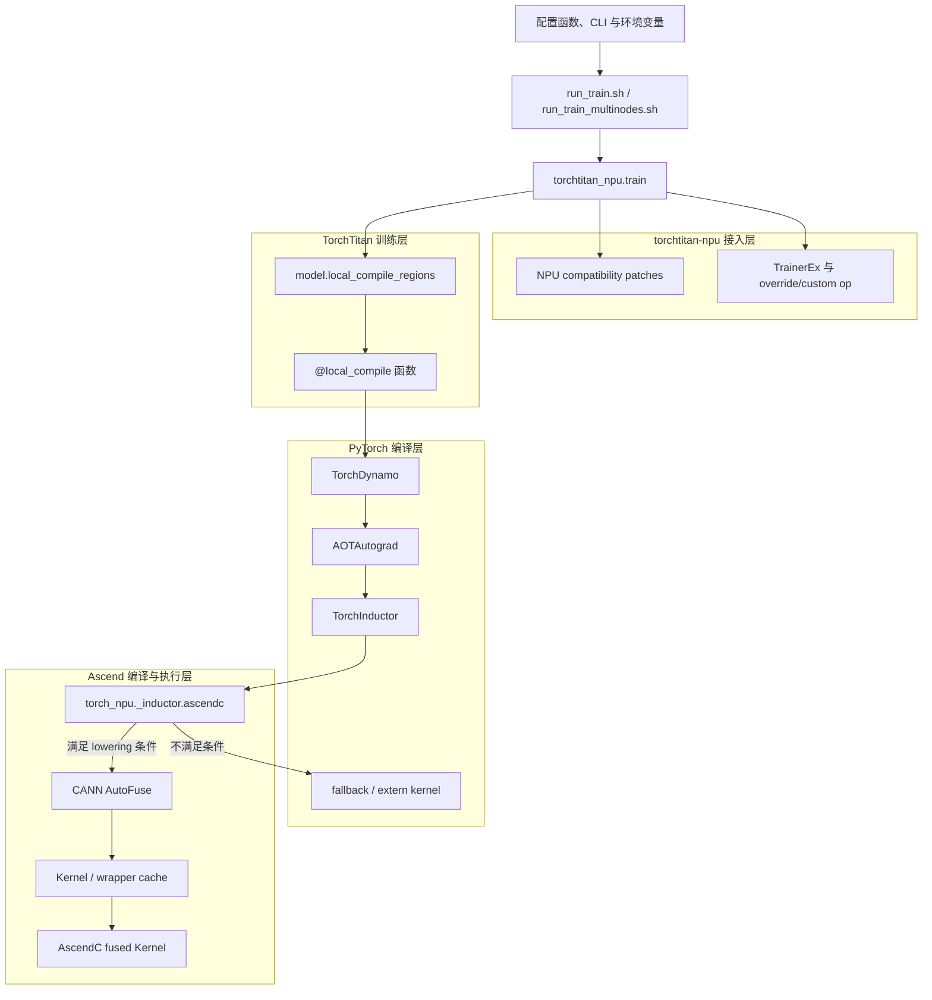

# torch.compile 与 AscendC AutoFuse 特性

TorchTitan 0.4.0 通过 Python recipe 选择局部编译区域。训练参数的配置方式见 [Python 配置指南](../developer_guides/python_recipes.md)。

本文说明 `torchtitan-npu` 如何复用 PyTorch `torch.compile` 与 TorchInductor，并通过
`torch_npu` 内置的 AscendC Codegen 接入 CANN AutoFuse。文档面向训练配置维护者、模型适配开发者和
融合算子开发者，重点说明启用方式、组件边界及容易被忽略的运行约束。

本文说明 `torchtitan-npu` 通过 TorchTitan 训练入口使用这些能力的方式。GraphTrainer 的整步图捕获和图级
通信优化属于独立编译体系，参见[DeepSeek-V4 GraphTrainer 编译路径适配](./deepseek_v4_graph_trainer.md)。

## 原生 DeepSeek-V4 局部编译

TorchTitan 0.4.0 的原生 V4 配方通过 `model.local_compile_regions` 选择 `@local_compile` 边界，训练循环保持 eager。
以下配方使用 8 张 A5 卡运行 43 层、16 路由专家的 DeepSeek-V4 Flash，采用 BF16、Full AC 和仓库的测试数据，
共训练 5 步。配方选择 `loss`、`fp32_to_bf16_split` 和 `rope` 区域。

```bash
NGPU=8 MODULE=torchtitan_npu_recipes.tests.models.deepseek_v4 \
  CONFIG=deepseek_v4_flash_43layers_16experts_local_compile_bf16_a5 \
  TORCH_DEVICE_BACKEND_AUTOLOAD=0 TORCHINDUCTOR_NPU_BACKEND=ascendc \
  bash scripts/run_train.sh --output-dir ./outputs/a5-bf16-fullac
```

- 空列表使用 eager；`["loss"]` 仅编译 loss。实际捕获取决于模型调用的组件。
- 配方通过现有 override 选择 NPU 算子。GraphTrainer 的整步编译使用其独立配置。
- A3 可复用 `deepseek_v4_flash_43layers_16experts_eager_bf16`，选择相同的局部编译区域。

## 1. 特性背景

PyTorch eager 模式按算子执行模型。训练图中大量 pointwise、reduction、view 和 cast 等小算子会产生重复的
Host 下发和中间 Tensor 读写。`torch.compile` 使用 TorchDynamo 捕获计算，通过 AOTAutograd 构造训练正反向图，
再由 TorchInductor 完成图优化、lowering、调度和代码生成。

`torchtitan-npu` 不重新实现 PyTorch 编译器，而是在 NPU 接入层完成以下工作：

- 通过 `model.local_compile_regions` 选择上游注册的编译区域；
- 选择 `torch_npu` 内置的 AscendC Inductor 后端；
- 在包导入阶段安装当前软件栈需要的 NPU 兼容 patch。

相关机制的边界如下：

| 机制 | 阶段 | 作用 |
| --- | --- | --- |
| TorchTitan 局部编译 | 模型并行化与训练 | 绑定已选择的 `@local_compile` 函数，并在调用时捕获计算 |
| AscendC AutoFuse | Inductor lowering 与 Codegen | 自动融合受支持的 Inductor 子图并生成 AscendC Kernel |
| override 与 custom op | 模型构建或明确算子边界 | 替换完整组件，或封装已有 CANN/Triton/PyPTO 算子 |

普通 ATen 图优先交给 AutoFuse；完整组件使用 override。这样可以保持模型代码与 NPU 后端解耦，
避免为同一目标维护多套 wrapper。

## 2. 用户使用场景与对外接口

通过 `MODULE` 和 `CONFIG` 选择 Python recipe，参见[原生 DeepSeek-V4 局部编译](#原生-deepseek-v4-局部编译)。
查看 launcher 选中的配置时可追加 `--print-config`。

| 环境变量 | 作用 |
| --- | --- |
| `TORCHINDUCTOR_NPU_BACKEND` | 选择 Inductor 的 NPU Codegen，示例使用 `ascendc` |
| `ASCEND_SET_ENV_PATH` | 指定 CANN 的 `set_env.sh`，未设置时按标准安装路径查找 |

## 3. 特殊背景及限制

### 3.1 PyTorch 编译后端与 NPU Codegen

局部编译的 PyTorch backend 由 `@local_compile` 的编译参数或 PyTorch 默认值决定。本页示例使用默认的
Inductor。`TORCHINDUCTOR_NPU_BACKEND=ascendc` 在 Inductor 内选择 NPU Codegen。

```text
torch.compile backend: inductor
              └── NPU Codegen backend: ascendc
```

`scripts/run_train.sh` 和 `scripts/run_train_multinodes.sh` 都在启动 Python 前默认设置 AscendC。需要指定
其他 Codegen 时，在启动前设置环境变量，并确保所有 rank 使用相同设置。

### 3.2 当前主线使用 `torch_npu` 内置后端

配套 AscendC backend 已随 `torch_npu` 安装到 `torch_npu/_inductor/ascendc`。当前主线不再要求额外安装或
手工导入旧版独立 `inductor_npu_ext`，也不再使用旧的 `npu_bypass_triton_codegen` 方案。

该后端依赖 PyTorch Inductor 内部 API，并调用配套 CANN AutoFuse。PyTorch、`torch_npu`、CANN 和
`torchtitan` 必须按照[软件安装](../user-guides/installation.md)与 [`requirements.txt`](../../requirements.txt)
配套使用，不能只升级其中一个组件后继续复用旧缓存。

### 3.3 局部编译区域要求完整成图

上游 `torchtitan.distributed.local_compile` 对选定的 `@local_compile` 函数使用
`torch.compile(..., fullgraph=True)`。函数首次调用时发生图捕获，区域内的 Dynamo graph break 会导致编译错误。

Inductor 对已经捕获图内不支持的节点仍可使用 fallback/extern kernel。Dynamo graph break 和 Inductor
fallback 发生在不同阶段，排障时需要区分。

### 3.4 动态 shape、fallback 和 custom op 均有边界

动态 shape 受 Dynamo guard、数据相关控制流、layout、stride、view、indirect indexing、SoC 和 dtype
支持范围限制。变长序列、packed layout 或不同路由 token 数能否复用同一个融合 kernel，需要分别验证。

训练 custom op 至少需要准确的 dispatcher schema、Fake/Meta 和 Autograd，并保持真实 mutation、alias、shape、
dtype、device 与 layout 语义。`torch.fx.wrap` 只阻止 Python wrapper 被展开，不会自动提供这些契约。

AscendC backend 可以保留不满足 lowering 条件的 fallback 节点。因此训练成功只证明路径可执行，不证明目标区域
已经融合；仍需检查 lowering 日志、Kernel 清单和 profiling。

### 3.5 首次编译、缓存和 profiling 需要隔离

`torch.compile` 使用惰性编译。第一次执行可能包含 Dynamo 捕获、AOTAutograd、Inductor 调度、AutoFuse
Codegen、C++ wrapper 和 AscendC Kernel 编译，不能用于稳态性能结论。

AscendC 融合 kernel 缓存在 Inductor 缓存目录的 `ascendc/` 子目录。`TORCHINDUCTOR_CACHE_DIR` 可指定缓存根目录。
缓存目录依赖文件锁，应使用支持文件锁的文件系统。切换软件版本、SoC、backend、模型图、关键 shape 或 custom op
后，应使用隔离缓存或定向失效相关产物。

下列调试选项会改变编译或执行行为，不能直接用于正式性能结论：

| 选项 | 影响 |
| --- | --- |
| `TORCHINDUCTOR_FORCE_DISABLE_CACHES=1` | 强制重新编译，增加启动时间 |
| `TORCHINDUCTOR_ASCENDC_DEBUG=+layoutcheck` | 增加运行时 layout 检查 |
| `ASCEND_LAUNCH_BLOCKING=1` | 改为同步下发，破坏异步执行 |
| `TORCHINDUCTOR_ASCENDC_DEBUG` | 根据所选选项改变 fallback、lowering 或融合结构 |
| `TORCHINDUCTOR_ASCENDC_AUTOTUNE_TOPN` | 控制自动调优的候选 tiling 数量 |

启用自动调优时，先完成编译和调优，再采集用于稳态分析的 profile。调试变量的具体取值以配套 `torch_npu` 为准。

## 4. 整体架构



控制流分为三层：TorchTitan 决定编译范围，`torchtitan-npu` 负责 NPU 接入和兼容，`torch_npu`/CANN 负责
实际 lowering、融合和 Kernel 生成。文档中的 `AutoFuse` 特指最后一层的通用自动融合，不包含 override 直接
调用的手写融合算子。

## 5. 核心实现

### 5.1 启动和包初始化

`scripts/run_train.sh` 与 `scripts/run_train_multinodes.sh` 最终通过 `torchrun` 启动
`torchtitan_npu.train`。训练入口复用上游 `torchtitan.train.main`，同时导入 `torchtitan_npu` 触发插件初始化。

当前包初始化顺序为：

```text
patches → config → extensions → ops
```

NPU patch 在模型构建和首次编译前生效。初始化 extensions 时，`extensions/compile/dynamo_config.py` 设置
Dynamo 的 `use_recursive_dict_tags_for_guards`，加快已匹配子树的 guard 检查。`specialize_float` 保持 PyTorch 默认值。

### 5.2 绑定和调用编译区域

原生 DeepSeek-V4 的执行顺序如下。

```text
模型构建与 override
    → BaseModel.parallelize 绑定局部编译区域
    → 模型内并行变换、Activation Checkpointing、FSDP
    → 训练中首次调用选定的函数时捕获图
```

`apply_local_compile()` 按进程绑定实现。训练中的 loss 函数和模型辅助函数使用同一注册机制，由各自的区域名
独立启用。普通 `TrainerEx` 要求 `config.compile` 为 `None`，区域选择通过
`config.model.local_compile_regions` 完成。GraphTrainer 使用独立的整步编译配置。

### 5.3 AscendC AutoFuse 与 fallback

选择 `ascendc` 后，`torch_npu` 向 Inductor 注册 NPU scheduling、wrapper Codegen、lowering、decomposition
和图优化。后端根据 op、SoC、dtype、shape、stride、layout、数据依赖和 mutation/alias 判断节点能否 lowering
和融合。

满足条件的节点形成融合组，由 CANN AutoFuse 生成 AscendC 图、tiling、Host wrapper 和 device Kernel；
不满足条件的节点保留为 fallback/extern kernel。这部分实现位于 `torch_npu` 和 CANN，本仓只负责选择、接入和
兼容。

### 5.4 NPU 兼容 patch

| Patch | 解决的问题 | 设计边界 |
| --- | --- | --- |
| `patches/torch_npu/device_copy.py` | non-blocking NPU-to-CPU copy 的 Host 可见性 | 只修正 NPU D2H 和 `prims.device_put`，不把 NPU 全局伪装为 GPU，避免误选 Triton 路径 |
| `patches/torch_npu/inductor_runtime_estimation.py` | 编译期 roofline 估算探测 CUDA/Triton，以及 standalone compile 的 GraphModule 复制路径 | 仅在 NPU 可用时安装；带宽常量只参与调度估算，不代表硬件峰值 |

两个 patch 都依赖包导入时机。CPU-only import 能验证模块可加载，但不能证明 NPU 条件分支已经生效。

### 5.5 与其他组件的交互

| 组件 | 交互约束 |
| --- | --- |
| override | 首次图捕获使用训练中实际调用的实现。区域内的替换算子需要满足 Fake/Meta、Autograd 和布局语义 |
| 量化训练 | `TrainerEx` 在模型构建前应用量化配置转换。局部编译区域单独选择 |
| 并行与重算 | 原生 DeepSeek-V4 要求 TP、CP、PP 均为 1。示例使用 EP8、FSDP8 和 Full AC |
| 多机训练 | 所有节点必须使用相同软件版本和 Codegen backend |

## 6. 验证、支持边界与关键文件索引

### 6.1 验证局部编译和 AutoFuse

1. 追加 `--print-config`，确认 `model.local_compile_regions` 与计划启用的区域一致。
2. 使用真实训练输入调用目标区域。排查图捕获时，在启动前设置
   `TORCH_LOGS=aot_graphs,graph_breaks,recompiles` 检查图、graph break 和重编译。
3. 使用 `TORCH_COMPILE_DEBUG=1` 检查 Inductor 编译产物及 lowering 和 fallback 日志。通过 profiling 确认
   实际执行的 `autofused_*` device kernel。
4. 使用相同 checkpoint、输入、并行配置和随机性比较 eager 与编译运行的 loss 和梯度范数。
5. 关闭额外调试开关，在预热完成后测量稳态性能。

配置输出只能确认区域已经选中。编译和融合分别以实际调用产生的图和运行时采集到的融合 kernel 为依据。
融合可能改变中间结果物化位置和浮点运算分组，数值验收应区分 bit-wise 一致、容差一致和收敛一致。

### 6.2 当前支持边界

| 能力 | 激活方式 | 当前状态与边界 |
| --- | --- | --- |
| 原生局部编译 | `model.local_compile_regions` 选择已注册的名称 | 空列表使用 eager。选择 `loss` 编译已注册的 loss 函数。选择 `rope` 或 `fp32_to_bf16_split` 后，在实际调用对应函数时捕获图 |
| AscendC AutoFuse | 使用 Inductor 并设置 `TORCHINDUCTOR_NPU_BACKEND=ascendc` | 融合范围由 `torch_npu`、CANN、SoC、dtype、shape 和 layout 决定 |
| `aot_eager` 诊断 | PyTorch 调试程序在绑定区域前设置 `torch.compiler.set_default_backend("aot_eager")` | 区域列表只选择函数。该诊断仅用于排查 Dynamo 和 AOTAutograd 的图捕获与正反向执行 |
| GraphTrainer | 选择对应的 `graph_trainer_*` 配方 | 使用独立的整步捕获和编译配置 |

源码存在某条路径不表示全部设备和并行组合均已验证。发布验证应记录模型、SoC、dtype、序列布局、并行策略和
完整软件版本。

### 6.3 关键文件索引

| 归属 | 文件或模块 | 作用 |
| --- | --- | --- |
| 本仓 | `scripts/run_train.sh` | 单机启动与 AscendC 默认 Codegen |
| 本仓 | `scripts/run_train_multinodes.sh` | 多机启动与 AscendC 默认 Codegen |
| 本仓 | `torchtitan_npu/train.py` | 复用上游训练入口并触发插件初始化 |
| 本仓 | `torchtitan_npu/__init__.py` | 固定 patches、config、extensions 和 ops 的加载顺序 |
| 本仓 | `torchtitan_npu/patches/torch_npu/device_copy.py` | NPU 异步 D2H 和 `device_put` 兼容 |
| 本仓 | `torchtitan_npu/patches/torch_npu/inductor_runtime_estimation.py` | NPU runtime estimation 和 standalone compile 兼容 |
| 本仓 | `torchtitan_npu/extensions/torchtitan/trainer.py` | NPU Trainer、量化转换与原生训练的 `config.compile` 校验 |
| 上游 TorchTitan | `torchtitan.distributed.local_compile`、`torchtitan.models.base.model.BaseModel.parallelize` | 注册并绑定函数级编译区域 |
| 外部依赖 | `torch_npu._inductor.ascendc` 与 CANN AutoFuse | NPU lowering、融合调度、tiling、Kernel 生成和编译 |

### 6.4 相关文档

- [融合算子接入指南](./fused_ops.md)
- [软件安装](../user-guides/installation.md)
